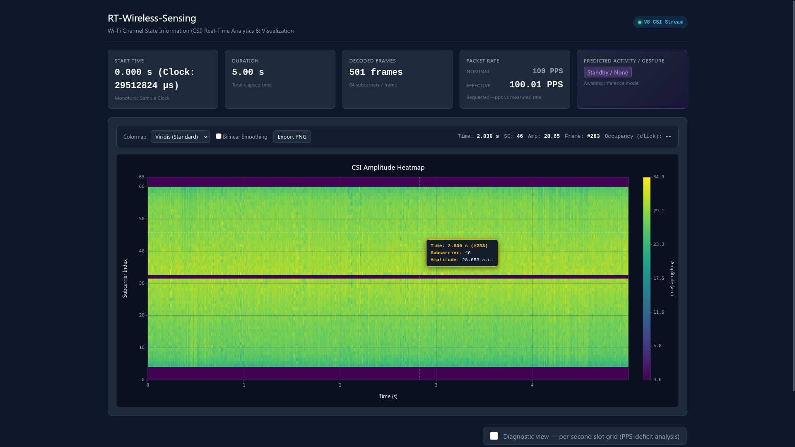
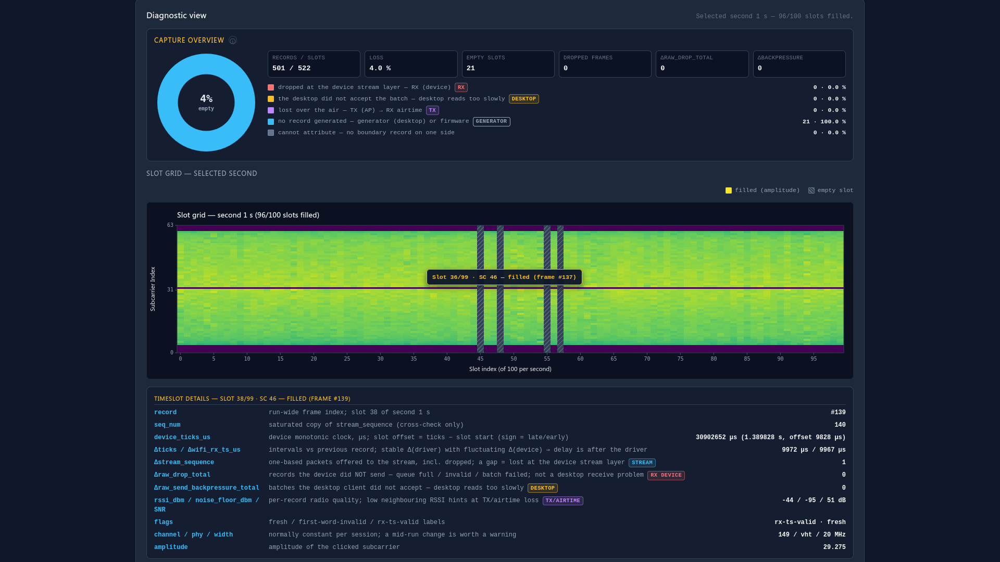
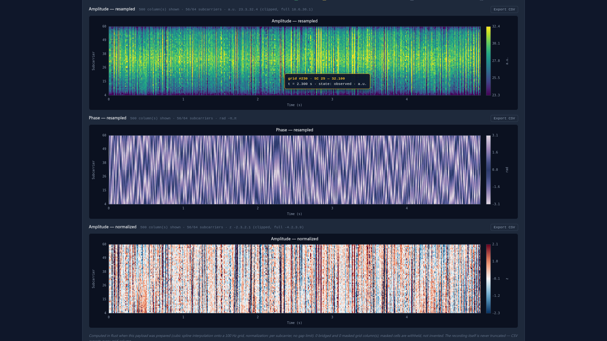

# RT-Wireless-sensing

A real-time wireless sensing and localization framework built with Rust,
supporting RF signal acquisition, processing, and edge AI inference for
applications such as human activity recognition and indoor positioning.
Currently this is used for Wi-Fi CSI sensing.

## Structure

- **Rust** (`src/`):
  - `collection.rs` — records the raw CSI stream from an ESPectre device.
  - `decoder.rs` — parses and validates the V8 CSI records.
  - `saving.rs` — decodes a capture and exports timestamp, amplitude, and phase
    arrays to `.npz`.
  - `dsp/` — offline signal processing over decoded CSI (`CsiSignal`): normalization,
    whole-record resampling, Hampel/biquad filters, FFT/STFT. Library only.
  - `visualization.rs` — prepares decoded CSI data for 2D amplitude heatmap rendering.
  - `streaming.rs` — collects and decodes CSI while serving a live 30 s sliding
    heatmap dashboard.
  - `csi_header.rs` — the 64-byte V8 record schema used by the decoder.
  - `main.rs` — default binary; runs the collection module with its default
    settings.
  - `bin/collect.rs`, `bin/decode.rs`, `bin/save.rs`, `bin/visualize.rs`,
    `bin/streaming.rs` — standalone CLIs for each module.
- **Web** (`web/`): HTML5, CSS3, and Vanilla JavaScript with HTML Canvas 2D for
  interactive heatmap rendering.
- **Samples** (`samples/`): a recorded V8 capture (`capture_v8.bin`) and the
  dashboard HTML rendered from it (`capture_v8_heatmap.html`).
- **Gallery** (`gallery/`): screenshots of the dashboard views, used by this
  README.
- **Documentation** (`docs_EN/`, `docs_VN/`): per-module API and
  standalone-command reference, in English and Vietnamese.

This project consumes ESPectre data in its own way: it owns the record schema,
the decoder, the processing and the presentation. It does **not** use ESPectre's
Python tooling or its plotting/statistics scripts — those are out of scope and
are not part of this repository. Custom ESP32 firmware may be built here in the
future.

## Modules

| Module | Source | Functionality | Docs | Standalone command |
|---|---|---|---|---|
| **Collection** | `src/collection.rs` | Opens `/espectre/v1/csi`, sends UDP markers at a configurable PPS (Packet per Second) rate, and writes the raw byte stream to a `.bin` capture. | [docs_EN/collection.md](docs_EN/collection.md) | `cargo run --bin collect` |
| **Decoder** | `src/decoder.rs` | Incrementally parses the 60-byte HTTP prefix and 64-byte V8 CSI header, validates counters, and exposes raw I/Q plus amplitude/phase. | [docs_EN/decoder.md](docs_EN/decoder.md) | `cargo run --bin decode -- capture_v8.bin` |
| **Saving** | `src/saving.rs` | Decodes a collected `.bin` and writes a same-stem `.npz` with 1 timestamp + 64 amplitude + 64 phase arrays (129 total for 64 subcarriers). | [docs_EN/saving.md](docs_EN/saving.md) | `cargo run --bin save -- capture_v8.bin` |
| **DSP** | `src/dsp/` | Synchronous signal processing over decoded CSI (`CsiSignal`): normalization, whole-record resampling, Hampel/median outlier removal, biquad LPF/HPF/BPF, FFT/STFT. Library only, no binary. | [docs_EN/dsp.md](docs_EN/dsp.md) | — |
| **Visualization** | `src/visualization.rs` | Renders a 2D CSI amplitude heatmap dashboard via HTML Canvas 2D, exportable as standalone HTML or served over HTTP, with a diagnostic slot view for PPS-deficit analysis. | [docs_EN/visualization.md](docs_EN/visualization.md) | `cargo run --bin visualize -- capture_v8.bin` |
| **Streaming** | `src/streaming.rs` | Collects and decodes CSI live, serving a 30 s sliding heatmap with a 3 s warm-up, 500 ms refresh, and click-to-compute occupancy. | [docs_EN/streaming.md](docs_EN/streaming.md) | `cargo run --bin streaming -- --help` |

The shared V8 record schema is in `src/csi_header.rs` and is documented with the
decoder.

## Pipeline

1. ESPectre ([github.com/francescopace/espectre](https://github.com/francescopace/espectre))
   runs on an ESP32 and produces CSI over the `/espectre/v1/csi` HTTP endpoint.
   This repository does not modify the firmware.
2. The **collection** module enables external-traffic sensing, sends UDP
   markers at the configured PPS, and writes the raw response body to
   `capture_v8.bin`. The default `main` binary does this with no arguments.
3. The **decoder** module turns those bytes into `CsiPacket` values (metadata +
   raw I/Q). It supports files, sockets, and frames split across reads.
4. The **saving** module decodes a capture and writes `capture_v8.npz` with
   `timestamp_ms`, `amplitude_00..63`, and `phase_00..63`. Timestamps are in
   milliseconds and start at 0, using the device's monotonic sample clock
   (`device_ticks_us`).
5. The **streaming** command composes collection, live decoding, and
   visualization in one process: it writes the raw `.bin`, starts the dashboard
   immediately, waits 3 seconds, then refreshes a 30-second sliding heatmap
   every 500 ms. Clicking a point reports the occupancy of that second:
   `N_filled / N` slots, where `N` is the configured PPS.
6. The **dsp** module processes decoded CSI offline: `CsiSignal` loaders
   (`.bin`/`.npz`), normalization, resampling onto a uniform grid, Hampel and
   biquad filters, and FFT/STFT spectra.
7. Downstream work (ONNX inference for localization) can consume the decoded
   packets or the `.npz` arrays. The AI pipeline is not implemented yet.

## Quick start

Assuming the ESP32 device is flashed with ESpectre firmware, the ESP is connected to the same hotspot as the desktop, preferably if the desktop is also the hotspot. This is an example command to create AP on linux desktop:

```
sudo create_ap --ieee80211n --ieee80211ac --vht-chwidth 20 -c 149 wlan0 wlan0 your_ssid your_pass
``` 

Then, unside ESpectre folder, run:

```bash
./espectre provision --ssid your_ssid
```

fill in the password, then ESpectre returns the endpoint:

```
Wi-Fi password (ESPECTRE_WIFI_PASSWORD is unset): 
Improv provisioning completed.
Device endpoint: http://192.168.12.253:62587/espectre/v1
```

This is the device IP needed to run the application:

```bash
# Decode and inspect the bundled sample capture (no device needed)
cargo run --bin decode -- samples/capture_v8.bin --quiet

# Record with the default device and output (same as `cargo run`)
cargo run --bin collect -- --ip 10.178.22.9 --output capture_v8.bin --pps 100 --duration 5

# Inspect the capture (optional)
cargo run --bin decode -- capture_v8.bin --quiet

# Export numeric arrays: capture_v8.bin -> capture_v8.npz
cargo run --bin save -- capture_v8.bin

# Visualize 2D amplitude heatmap (generates standalone capture_v8_heatmap.html)
cargo run --bin visualize -- samples/capture_v8.bin --open

# Collect and visualize live at the same time (open http://127.0.0.1:8080)
cargo run --bin streaming -- --ip 10.178.22.9 --output capture_v8.bin --pps 100 --port 8080

# Load the result in Python
python3 -c 'import numpy as np; d=np.load("capture_v8.npz"); print(len(d.files), d["timestamp_ms"].shape)'
```

The bundled sample `samples/capture_v8.bin` decodes to 501 records over 4.999 s
at 100.01 records/s and produces `129` arrays of length `501`;
`samples/capture_v8_heatmap.html` is the dashboard rendered from it. The file
name follows the `capture_v8.bin` naming convention only — it is **not** the
older 691-record capture that the integration tests still use (see
[Tests](#tests)). It was recorded with a desktop machine acting as the access
point (AP), as described in [Quick start](#quick-start).

An example of the Web UI interface during streaming:

Inspecting the diagnostic view:

DSP view:


## Documentation

- [Module index and typical flow](docs_EN/README.md)
- [Collection module](docs_EN/collection.md)
- [Decoder module](docs_EN/decoder.md)
- [Saving module](docs_EN/saving.md)
- [DSP module](docs_EN/dsp.md)
- [Visualization module](docs_EN/visualization.md)
- [Streaming module](docs_EN/streaming.md)

API documentation is also available from rustdoc:

```bash
cargo doc --open
```

## Tests

```bash
cargo test --all-targets
cargo clippy --all-targets
```

The integration tests decode an older reference capture (`capture_v8.bin`, 691
frames, 34.5 s at 20 PPS, payload hash `0x6446fc78e2c7f3e6`) and verify the
exported `.npz` layout and values. That file is not tracked; the tests expect it
at the repository root, so copy the git-ignored copy into place first:

```bash
cp artifacts/capture_v8.bin .
cargo test --all-targets
```


---

# RT-Wireless-Sensing (Tiếng Việt)

Một framework cảm biến và định vị không dây theo thời gian thực được xây dựng bằng Rust,
hỗ trợ thu thập tín hiệu RF, xử lý và suy luận AI tại edge cho các ứng dụng như
nhận dạng hoạt động con người và định vị trong nhà. Hiện tại được sử dụng cho cảm biến CSI Wi-Fi.

## Cấu trúc

- **Rust** (`src/`):
  - `collection.rs` — ghi dòng CSI thô từ thiết bị ESPectre.
  - `decoder.rs` — phân tích và xác thực các bản ghi CSI V8.
  - `saving.rs` — giải mã bản ghi và xuất mảng timestamp, biên độ, và pha
    sang `.npz`.
  - `dsp/` — xử lý tín hiệu offline trên CSI đã giải mã (`CsiSignal`): chuẩn hóa,
    resample, lọc Hampel/biquad, FFT/STFT. Chỉ thư viện.
  - `visualization.rs` — chuẩn bị dữ liệu CSI đã giải mã để render heatmap biên độ 2D.
  - `streaming.rs` — thu thập và giải mã CSI đồng thời phục vụ bảng điều khiển heatmap trượt 30 giây.
  - `csi_header.rs` — schema bản ghi V8 64-byte được sử dụng bởi bộ giải mã.
  - `main.rs` — nhị phân mặc định; chạy mô-đun thu thập với cài đặt mặc định.
  - `bin/collect.rs`, `bin/decode.rs`, `bin/save.rs`, `bin/visualize.rs`,
    `bin/streaming.rs` — các CLI độc lập cho từng mô-đun.
- **Web** (`web/`): HTML5, CSS3, và Vanilla JavaScript với HTML Canvas 2D để
  render heatmap tương tác.
- **Mẫu** (`samples/`): một bản ghi V8 (`capture_v8.bin`) và trang HTML dashboard
  được render từ nó (`capture_v8_heatmap.html`).
- **Gallery** (`gallery/`): ảnh chụp các chế độ xem của dashboard, dùng cho README này.
- **Tài liệu** (`docs_EN/`, `docs_VN/`): API theo mô-đun và tham chiếu lệnh độc lập,
  bằng tiếng Anh và tiếng Việt.

Dự án này sử dụng dữ liệu của ESPectre theo cách riêng: nó tự quản lý schema bản
ghi, bộ giải mã, phần xử lý và phần hiển thị. Dự án **không** dùng bộ công cụ
Python của ESPectre hay các script vẽ biểu đồ/thống kê của ESPectre — những thứ
đó nằm ngoài phạm vi và không thuộc kho lưu trữ này. Firmware ESP32 tùy biến có
thể được xây dựng tại đây trong tương lai.

## Mô-đun

| Mô-đun | Nguồn | Chức năng | Tài liệu | Lệnh độc lập |
|---|---|---|---|---|
| **Thu thập** | `src/collection.rs` | Mở `/espectre/v1/csi`, gửi marker UDP, và ghi dòng byte thô vào tệp `.bin`. | [docs_EN/collection.md](docs_EN/collection.md) | `cargo run --bin collect` |
| **Giải mã** | `src/decoder.rs` | Phân tích từng phần prefix HTTP 60-byte và header CSI V8 64-byte, xác thực bộ đếm, và phơi bày I/Q thô cùng biên độ/pha. | [docs_EN/decoder.md](docs_EN/decoder.md) | `cargo run --bin decode -- capture_v8.bin` |
| **Lưu trữ** | `src/saving.rs` | Giải mã tệp `.bin` đã thu thập và ghi tệp `.npz` cùng tên gốc với 1 timestamp + 64 biên độ + 64 pha (tổng 129 cho 64 subcarrier). | [docs_EN/saving.md](docs_EN/saving.md) | `cargo run --bin save -- capture_v8.bin` |
| **DSP** | `src/dsp/` | Xử lý tín hiệu đồng bộ trên CSI đã giải mã (`CsiSignal`): chuẩn hóa, resample toàn bản ghi, lọc Hampel/biquad, FFT/STFT. Chỉ thư viện, không có nhị phân. | [docs_EN/dsp.md](docs_EN/dsp.md) | — |
| **Hiển thị** | `src/visualization.rs` | Render bảng điều khiển heatmap biên độ CSI 2D thông qua HTML Canvas 2D, có thể xuất dưới dạng HTML độc lập hoặc phục vụ qua HTTP. | [docs_EN/visualization.md](docs_EN/visualization.md) | `cargo run --bin visualize -- capture_v8.bin` |
| **Phát trực tuyến** | `src/streaming.rs` | Thu thập và giải mã CSI trực tiếp, phục vụ heatmap trượt 30 giây với 3 giây khởi động, làm mới 500 ms, và tính toán độ chiếm chỗ khi nhấp. | [docs_EN/streaming.md](docs_EN/streaming.md) | `cargo run --bin streaming -- --help` |

Schema bản ghi V8 chung ở `src/csi_header.rs` và được tài liệu hóa cùng với bộ giải mã.

## Pipeline

1. ESPectre ([github.com/francescopace/espectre](https://github.com/francescopace/espectre))
   chạy trên ESP32 và sản xuất CSI qua endpoint HTTP `/espectre/v1/csi`.
   Kho lưu trữ này không sửa đổi firmware.
2. Mô-đun **thu thập** bật cảm biến lưu lượng bên ngoài, gửi
   marker UDP ở PPS được cấu hình, và ghi nội dung phản hồi thô vào
   `capture_v8.bin`. Nhị phân `main` mặc định làm điều này mà không có đối số.
3. Mô-đun **giải mã** chuyển đổi các byte đó thành giá trị `CsiPacket` (metadata +
   I/Q thô). Nó hỗ trợ tệp, socket, và khung chia trên nhiều lần đọc.
4. Mô-đun **lưu trữ** giải mã bản ghi và ghi `capture_v8.npz` với
   `timestamp_ms`, `amplitude_00..63`, và `phase_00..63`. Timestamp bắt đầu từ
   0, sử dụng đồng hồ mẫu đơn điệu của thiết bị (`device_ticks_us`).
5. Lệnh **phát trực tuyến** kết hợp thu thập, giải mã trực tiếp, và
   hiển thị trong một quá trình: nó ghi tệp `.bin` thô, khởi động bảng điều khiển
   ngay lập tức, chờ 3 giây, rồi làm mới heatmap trượt 30 giây
   mỗi 500 ms. Nhấp vào một điểm báo cáo độ chiếm chỗ của giây đó:
   `N_đã_điền / N` khe, trong đó `N` là PPS được cấu hình.
6. Mô-đun **dsp** xử lý CSI đã giải mã offline: các bộ nạp `CsiSignal`
   (`.bin`/`.npz`), chuẩn hóa, resample lên lưới đều, bộ lọc Hampel và
   biquad, và phổ FFT/STFT.
7. Công việc hạ nguồn (suy luận ONNX cho định vị) có thể tiêu thụ các gói tin đã giải mã
   hoặc mảng `.npz`. Pipeline AI chưa được triển khai.

## Bắt đầu nhanh

```bash
# Giải mã và kiểm tra bản ghi mẫu có sẵn (không cần thiết bị)
cargo run --bin decode -- samples/capture_v8.bin --quiet

# Ghi với thiết bị và đầu ra mặc định (giống với `cargo run`)
cargo run --bin collect -- --ip 10.178.22.9 --output capture_v8.bin --pps 100

# Kiểm tra bản ghi (tùy chọn)
cargo run --bin decode -- capture_v8.bin --quiet

# Xuất mảng số: capture_v8.bin -> capture_v8.npz
cargo run --bin save -- capture_v8.bin

# Hiển thị heatmap biên độ 2D (tạo capture_v8_heatmap.html độc lập)
cargo run --bin visualize -- samples/capture_v8.bin --open

# Thu thập và hiển thị trực tiếp cùng lúc (mở http://127.0.0.1:8080)
cargo run --bin streaming -- --ip 10.178.22.9 --output capture_v8.bin --pps 100 --port 8080

# Đọc kết quả bằng Python
python3 -c 'import numpy as np; d=np.load("capture_v8.npz"); print(len(d.files), d["timestamp_ms"].shape)'
```

Bản ghi mẫu có sẵn `samples/capture_v8.bin` giải mã thành 501 bản ghi trong
4.999 s với 100.01 bản ghi/s và tạo ra `129` mảng có độ dài `501`;
`samples/capture_v8_heatmap.html` là dashboard render từ bản ghi đó. Tên tệp chỉ
theo quy ước đặt tên `capture_v8.bin` — đây **không phải** bản ghi 691 bản ghi cũ
mà các kiểm tra tích hợp vẫn dùng (xem [Kiểm tra](#kiểm-tra)). Bản ghi này được
thu với máy tính để bàn đóng vai trò access point (AP), như mô tả ở
[Bắt đầu nhanh](#bắt-đầu-nhanh).

Một ví dụ về giao diện UI Web trong quá trình phát trực tuyến:

Xem chế độ chẩn đoán:

Chế độ DSP:


## Tài liệu

- [Danh mục mô-đun và luồng điển hình](docs_EN/README.md)
- [Mô-đun thu thập](docs_EN/collection.md)
- [Mô-đun giải mã](docs_EN/decoder.md)
- [Mô-đun lưu trữ](docs_EN/saving.md)
- [Mô-đun DSP](docs_EN/dsp.md)
- [Mô-đun hiển thị](docs_EN/visualization.md)
- [Mô-đun phát trực tuyến](docs_EN/streaming.md)

Tài liệu API cũng có sẵn từ rustdoc:

```bash
cargo doc --open
```

## Kiểm tra

```bash
cargo test --all-targets
cargo clippy --all-targets
```

Các kiểm tra tích hợp giải mã một bản ghi tham chiếu cũ (`capture_v8.bin`, 691
khung, 34.5 s ở 20 PPS, hash payload `0x6446fc78e2c7f3e6`) và xác minh bố cục và
giá trị của tệp `.npz` đã xuất. Tệp này không được theo dõi trong git; các kiểm
tra tìm nó ở thư mục gốc của kho lưu trữ, nên hãy chép bản trong `artifacts/`
(git-ignored) vào trước:

```bash
cp artifacts/capture_v8.bin .
cargo test --all-targets
```

---

**Tài liệu bằng Tiếng Việt có sẵn tại:** [docs_VN/](docs_VN/)
