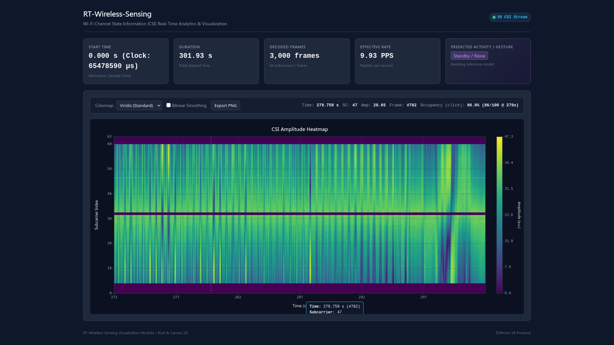

# RT-Wireless-sensing

A real-time wireless sensing and localization framework built with Rust,
supporting RF signal acquisition, processing, and edge AI inference for
applications such as human activity recognition and indoor positioning.
Currently this is used for Wi-Fi CSI sensing.

## Structure

- **Rust** (`src/`):
  - `collection.rs` — records the raw CSI stream from an ESPectre device.
  - `decoder.rs` — parses and validates the V8 CSI records.
  - `saving.rs` — decodes a capture and exports timestamp, amplitude, and phase
    arrays to `.npz`.
  - `visualization.rs` — prepares decoded CSI data for 2D amplitude heatmap rendering.
  - `streaming.rs` — collects and decodes CSI while serving a live 30 s sliding
    heatmap dashboard.
  - `csi_header.rs` — the 64-byte V8 record schema used by the decoder.
  - `main.rs` — default binary; runs the collection module with its default
    settings.
  - `bin/collect.rs`, `bin/decode.rs`, `bin/save.rs`, `bin/visualize.rs`,
    `bin/streaming.rs` — standalone CLIs for each module.
- **Web** (`web/`): HTML5, CSS3, and Vanilla JavaScript with HTML Canvas 2D for
  interactive heatmap rendering.
- **Python** (`scripts/`): creates plots and performs statistics to validate
  CSI data.
- **Documentation** (`docs/`): per-module API and standalone-command reference.

## Modules

| Module | Source | Functionality | Docs | Standalone command |
|---|---|---|---|---|
| **Collection** | `src/collection.rs` | Opens `/espectre/v1/csi`, sends UDP markers, and writes the raw byte stream to a `.bin` capture. | [docs/collection.md](docs/collection.md) | `cargo run --bin collect` |
| **Decoder** | `src/decoder.rs` | Incrementally parses the 60-byte HTTP prefix and 64-byte V8 CSI header, validates counters, and exposes raw I/Q plus amplitude/phase. | [docs/decoder.md](docs/decoder.md) | `cargo run --bin decode -- capture_v8.bin` |
| **Saving** | `src/saving.rs` | Decodes a collected `.bin` and writes a same-stem `.npz` with 1 timestamp + 64 amplitude + 64 phase arrays (129 total for 64 subcarriers). | [docs/saving.md](docs/saving.md) | `cargo run --bin save -- capture_v8.bin` |
| **Visualization** | `src/visualization.rs` | Renders a 2D CSI amplitude heatmap dashboard via HTML Canvas 2D, exportable as standalone HTML or served over HTTP. | [docs/visualization.md](docs/visualization.md) | `cargo run --bin visualize -- capture_v8.bin` |
| **Streaming** | `src/streaming.rs` | Collects and decodes CSI live, serving a 30 s sliding heatmap with a 3 s warm-up, 500 ms refresh, and click-to-compute occupancy. | [docs/streaming.md](docs/streaming.md) | `cargo run --bin streaming -- --help` |

The shared V8 record schema is in `src/csi_header.rs` and is documented with the
decoder.

## Pipeline

1. ESPectre ([github.com/francescopace/espectre](https://github.com/francescopace/espectre))
   runs on an ESP32 and produces CSI over the `/espectre/v1/csi` HTTP endpoint.
   This repository does not modify the firmware.
2. The **collection** module enables external-traffic sensing, sends UDP
   markers at the configured PPS, and writes the raw response body to
   `capture_v8.bin`. The default `main` binary does this with no arguments.
3. The **decoder** module turns those bytes into `CsiPacket` values (metadata +
   raw I/Q). It supports files, sockets, and frames split across reads.
4. The **saving** module decodes a capture and writes `capture_v8.npz` with
   `timestamp_ms`, `amplitude_00..63`, and `phase_00..63`. Timestamps are in
   milliseconds and start at 0, using the device's monotonic sample clock
   (`device_ticks_us`).
5. The **streaming** command composes collection, live decoding, and
   visualization in one process: it writes the raw `.bin`, starts the dashboard
   immediately, waits 3 seconds, then refreshes a 30-second sliding heatmap
   every 500 ms. Clicking a point reports the occupancy of that second:
   `N_filled / N` slots, where `N` is the configured PPS.
6. Downstream work (ONNX inference for localization) can consume the decoded
   packets or the `.npz` arrays. The AI pipeline is not implemented yet.

## Quick start

```bash
# Record with the default device and output (same as `cargo run`)
cargo run --bin collect -- --ip 10.178.22.9 --output capture_v8.bin --pps 100

# Inspect the capture (optional)
cargo run --bin decode -- capture_v8.bin --quiet

# Export numeric arrays: capture_v8.bin -> capture_v8.npz
cargo run --bin save -- capture_v8.bin

# Visualize 2D amplitude heatmap (generates standalone capture_v8_heatmap.html)
cargo run --bin visualize -- capture_v8.bin --open

# Collect and visualize live at the same time (open http://127.0.0.1:8080)
cargo run --bin streaming -- --ip 10.178.22.9 --output capture_v8.bin --pps 100 --port 8080

# Load the result in Python
python3 -c 'import numpy as np; d=np.load("capture_v8.npz"); print(len(d.files), d["timestamp_ms"].shape)'
```

The repository's `capture_v8.bin` decodes to 691 records and produces
`129` arrays of length `691`.

An example of the Web UI interface during streaming:


## Documentation

- [Module index and typical flow](docs/README.md)
- [Collection module](docs/collection.md)
- [Decoder module](docs/decoder.md)
- [Saving module](docs/saving.md)
- [Visualization module](docs/visualization.md)
- [Streaming module](docs/streaming.md)

API documentation is also available from rustdoc:

```bash
cargo doc --open
```

## Tests

```bash
cargo test --all-targets
cargo clippy --all-targets
```

The integration tests decode the real `capture_v8.bin` (691 frames, payload
hash `0x6446fc78e2c7f3e6`) and verify the exported `.npz` layout and values.

